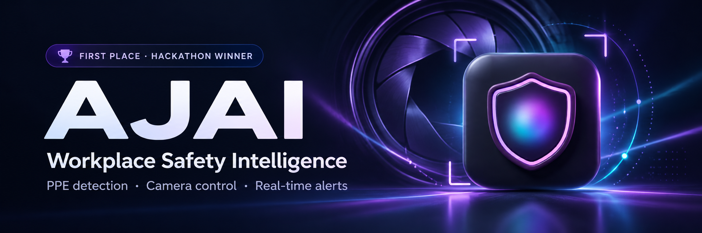
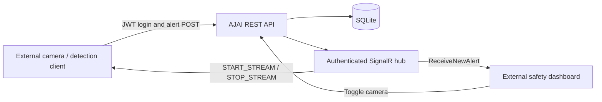
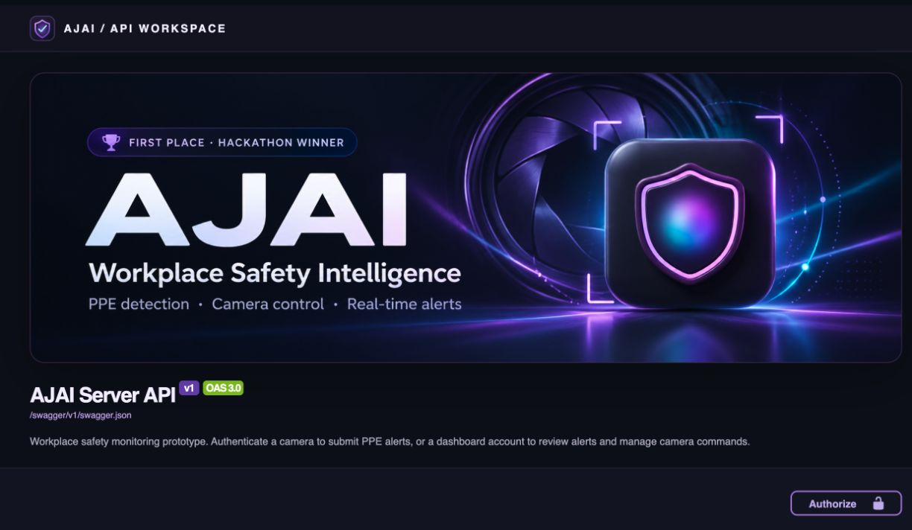

<p align="center">
  
</p>
<p align="center"><strong>ASP.NET Core · YOLO11 · SignalR · SQLite</strong></p>
<p align="center"><a href="#run-locally">Run locally</a> · <a href="docs/API.md">API reference</a> · <a href="ai/README.md">AI worker</a> · <a href="docs/ARCHITECTURE.md">Architecture</a></p>

The original AJAI project won first place at a hackathon. It focuses on detecting missing personal protective equipment (PPE) and sending alerts to a safety dashboard. This repository contains the **backend service** and a replacement **local AI worker**. It receives alerts from an external camera or detection client, stores them, and sends live updates to authenticated dashboard users.

**Project status:** backend plus real still-image AI inference. A public pretrained YOLO11n model replaces the lost original model. Its source, license, and verified download are documented. The Vue dashboard and live camera capture software are still missing. The .NET API stores alerts; the separate Python worker performs detection. No model accuracy or live-video performance is claimed.

## Features

- Separate login permissions for dashboard users and camera clients.
- Signed JWTs with issuer, audience, and expiration checks.
- Camera listing and remote start/stop command events.
- Validated alert ingestion with a camera identity check.
- Latest 50 alerts, stored in SQLite with UTC timestamps.
- Authenticated SignalR groups for dashboard alerts and camera commands.
- Automatic database migrations, optional local demo accounts, and Swagger UI.
- Integration tests and a GitHub Actions build/test workflow.

## How it works



The included [AI worker](ai/README.md) can detect helmet and vest warnings in an image and submit alerts. The external dashboard and live camera client must be supplied separately. Camera commands are messages; this backend cannot confirm that hardware acted on them.

## Run locally

Requires the [.NET 9 SDK](https://dotnet.microsoft.com/en-us/download/dotnet/9.0). Commands below use Bash/zsh from the repository root. PowerShell users can set the same values through `dotnet user-secrets`.

1. Restore dependencies:

   ```bash
   dotnet restore AJAI.sln
   ```

2. Store a random signing key outside the repository:

   ```bash
   dotnet user-secrets set 'Jwt:Key' "$(openssl rand -base64 48)" --project src/AJAI.Server
   ```

3. Enable optional local demo accounts with passwords you choose. Replace both placeholders with different passwords of at least 12 characters:

   ```bash
   dotnet user-secrets set 'Demo:Enabled' 'true' --project src/AJAI.Server
   dotnet user-secrets set 'Demo:AdminPassword' 'YOUR-LOCAL-ADMIN-PASSWORD' --project src/AJAI.Server
   dotnet user-secrets set 'Demo:CameraPassword' 'YOUR-LOCAL-CAMERA-PASSWORD' --project src/AJAI.Server
   ```

4. Start the API:

   ```bash
   dotnet run --project src/AJAI.Server --launch-profile http
   ```

5. Open [Swagger UI](http://localhost:5102). Sign in through `POST /api/Auth/login` using `admin@example.test` or `camera1@example.test` and the password you set. Use the returned token in Swagger's **Authorize** dialog.

The first start creates a fresh `ajai.db` in the app directory. Demo accounts are created only in Development when explicitly enabled. Changing a demo password setting does not update an existing account. To reset disposable local data, stop the app and remove its ignored SQLite files before restarting. Do not reuse a database from the original hackathon folder.

## Real AI detection

The replacement model runs locally through ONNX Runtime. It uses no paid AI API. Read the [AI setup guide](ai/README.md) to install Python dependencies, download the verified model, run an image, and send real predictions to AJAI. The [model card](ai/MODEL_CARD.md) records its external source, exact revision, checksum, labels, and AGPL-3.0 license.

```bash
python ai/ajai_ai.py detect /path/to/photo.jpg --post-alerts
```

Run the setup first and supply camera credentials through environment variables. The original AJAI model was not recovered or retrained.

## API workspace

The development API page includes the AJAI banner, shield favicon, and a matching dark theme. Open the local Swagger UI after starting the server. This is the API documentation interface, not the missing Vue camera dashboard.

<details>
<summary>View the actual API workspace</summary>



</details>

## API overview

| Method | Route | Access | Purpose |
| --- | --- | --- | --- |
| GET | `/health` | Public | Process health |
| POST | `/api/Auth/login` | Public, rate limited | Obtain a one-hour JWT |
| GET | `/api/Cameras` | User | List cameras without password hashes |
| POST | `/api/Cameras/toggle/{id}` | User | Toggle state and send a command |
| POST | `/api/Alerts` | Camera | Store an alert for the signed-in camera |
| GET | `/api/Alerts` | User | Read the latest 50 alerts |
| SignalR | `/dashboardHub` | Authenticated | Receive events and join authorized groups |

See [API examples](docs/API.md) for request bodies and the SignalR contract.

## Verify

```bash
dotnet build AJAI.sln --configuration Release
dotnet test AJAI.sln --configuration Release --no-build
```

Tests use isolated temporary SQLite databases and exercise login, access control, alert persistence, camera commands, and real-time delivery. The GitHub workflow runs the same build and tests on push and pull requests.

## Repository layout

```text
ai/                         Real ONNX inference, model downloader, and Python tests
src/AJAI.Server/             API, data models, migrations, and SignalR hub
tests/AJAI.Server.Tests/     HTTP and real-time integration tests
docs/                       API contract, architecture, and review notes
.github/                    CI, dependency updates, and issue/PR templates
```

## Configuration and limits

Secrets belong in user-secrets or environment variables such as `Jwt__Key`. The app does not load `.env` files. Set `Cors__AllowedOrigins__0` for the actual dashboard origin and configure `AllowedHosts` for your deployment hostname. Default CORS permits `http://localhost:3000`; it does not create a dashboard.

Production requires HTTPS hosting and separately provisioned accounts. Demo seeding and Swagger UI are disabled outside Development. See [security guidance](SECURITY.md).

The backend has no account management API, token revocation, live frame pipeline, heartbeat monitor, or alert retention job. `LastPing` updates at camera login; it is not a live connectivity indicator. A toggle stores the requested camera state; it is not a hardware acknowledgment.

.NET 9 is close to the end of its support period. Upgrade to .NET 10 LTS before long-term deployment. See Microsoft's [support policy](https://dotnet.microsoft.com/en-us/platform/support/policy/dotnet-core).

## Documentation

- [AI setup and inference](ai/README.md)
- [Replacement model provenance](ai/MODEL_CARD.md)
- [Architecture and design decisions](docs/ARCHITECTURE.md)
- [Project review and changes](docs/PROJECT_REVIEW.md)
- [Contributing](CONTRIBUTING.md)
- [Security](SECURITY.md)

## Ownership and licensing

This project originated as team hackathon work. No license has been selected for the AJAI team code. The third-party model has its own AGPL-3.0 license, preserved under `ai/third_party/`. Confirm team ownership and permission for the code and supplied logo before public publication. Add a license only after the rights holders agree. Public visibility alone does not grant permission to reuse the work.
